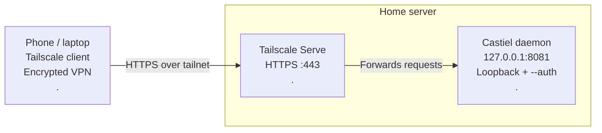

# Running castiel on a server with Tailscale

castiel is a desktop app, but nothing stops you from running it on a Linux server and reaching it from your phone, tablet, or laptop. For this purpose, castiel provides the `--auth` and `--bind` flags. Security matters, since castiel is effectively a remote code-execution machine. The `--auth` flag protects every API call with an access token: on first start, castiel generates a cryptographically random 256-bit token, stores it owner-only in `~/.config/castiel/auth.json`, and prints it once to the log. Devices log in with the token once and receive a short-lived session cookie; scripts can pass it directly as a bearer token. 

This is pretty secure, but for further security the recommended approach is [Tailscale](https://tailscale.com): you reach the server through a tailnet, a private, encrypted network only your own devices can join. This guide takes a first-time user from an empty server to a working, phone-accessible castiel in about ten minutes.

The architecture looks like this:



The request flow: your device connects through the tailnet, `tailscale serve` terminates HTTPS for `https://<your-server>.<tailnet>.ts.net` and forwards to castiel which never sees anything but loopback traffic on `127.0.0.1:8081`.

Why this is the recommended way to expose castiel:

- **castiel never leaves the loopback interface.** It listens on `127.0.0.1:8081`, so nothing on the server's LAN or the internet can reach it directly. Only the tailscale daemon, which proxies it.
- **Real HTTPS inside the tailnet.** `tailscale serve` terminates TLS with a valid certificate for `https://<your-server>.<tailnet>.ts.net`. castiel detects the proxy via the `X-Forwarded-Proto: https` header and marks its login cookie `Secure` accordingly.
- **Token auth stays on.** castiel runs with `--auth`, so even a tailnet device needs the access token to drive the API. Which executes commands on the server, so this matters.
- **No public exposure.** Unlike `tailscale funnel` (which publishes a service to the public internet, do **not** use it for castiel), `tailscale serve` is tailnet-only.

## Prerequisites

- A Linux server (x86_64) with SSH access.
- A [Tailscale](https://tailscale.com) account.
- The Tailscale app on the device you'll access castiel from (e.g. your phone).
- `curl` and `tar` on the server (present on virtually every distribution).

## Install Tailscale on the server

```sh
curl -fsSL https://tailscale.com/install.sh | sh
sudo tailscale up
```

`tailscale up` prints an authentication URL. Open it in a browser, log in, and approve the device. The server now appears in your [Tailscale admin console](https://login.tailscale.com).

Two tailnet settings must be on for the next steps (both are under the admin console, _DNS_ tab):

1. **MagicDNS**: gives the server a stable name like `castiel.tail1234.ts.net`.
2. **HTTPS Certificates**: lets `tailscale serve` issue valid certificates for those names.

If you don't enable them here, `tailscale serve` will offer to enable HTTPS for you when you first run it.

## Install castiel from the latest release

The easiest way is the installer script, which downloads the latest Linux release, installs a self-contained app image into your home directory, and puts a `castiel` command on your PATH:

```sh
curl -fsSL https://iso53.github.io/castiel/install.sh | bash
```

This installs to `~/.local/share/castiel` and symlinks the launcher to `~/.local/bin/castiel`. Make sure `~/.local/bin` is on your PATH (the installer tells you if it isn't, add `export PATH="$HOME/.local/bin:$PATH"` to `~/.bashrc`), then verify:

```sh
castiel --version
```

<details>
<summary>Manual alternative (without the installer script)</summary>

Download the latest bundle directly from the release:

```sh
curl -L -o /tmp/castiel.tar.gz \
  https://github.com/ISO53/castiel/releases/latest/download/castiel-linux-x64.tar.gz
mkdir -p ~/.local/share
tar -xzf /tmp/castiel.tar.gz -C ~/.local/share
rm /tmp/castiel.tar.gz
ln -sf ~/.local/share/castiel/bin/castiel ~/.local/bin/castiel
```

Linux bundles are x86_64-only; there is no arm64 Linux build yet.
</details>

The bundle is self-contained: no Java, Node, or other runtime dependencies.

## Run castiel as a daemon

For a server, castiel should run as a systemd service: it survives SSH disconnects, restarts on failure, and starts on boot.

Create the unit file (replace nothing, the variables expand to your own user):

```sh
sudo tee /etc/systemd/system/castiel.service > /dev/null <<EOF
[Unit]
Description=castiel pentesting harness
After=network-online.target

[Service]
Type=simple
User=$USER
WorkingDirectory=$HOME
ExecStart=$HOME/.local/share/castiel/bin/castiel --auth --log-file $HOME/castiel.log
Restart=on-failure

[Install]
WantedBy=multi-user.target
EOF

sudo systemctl daemon-reload
sudo systemctl enable --now castiel
```

Check that it is running:

```sh
systemctl status castiel --no-pager
```

The important flags in `ExecStart`:

- `--auth`: require token authentication for every API call. Mandatory here: castiel executes commands on the server, and a daemonized instance must never accept anonymous commands. On first boot with `--auth`, a 256-bit access token is generated and stored owner-only in `~/.config/castiel/auth.json` (and printed once in the boot log).
- `--log-file ~/castiel.log`: mirror logs to a file next to the console output, rotated automatically.

::: warning Don't double-run
Either castiel runs as the daemon or you start it manually in a terminal. Never both at once. The second instance fails to bind port 8081. To run it interactively for a while, stop the service first (`sudo systemctl stop castiel`), and start it again when done.
:::

## Get the access token

```sh
castiel --show-token
```

This prints the stored access token (run it as the same user the service runs as. The token lives in `~/.config/castiel/auth.json`). Copy it; you'll paste it into the login screen on your phone. You can rotate it later with `castiel --reset-token` (takes effect on the next start and drops all open sessions).

## Expose castiel with `tailscale serve`

One command, run once. The configuration is persistent inside the tailscale daemon, so it survives reboots and SSH disconnects:

```sh
sudo tailscale serve --bg 8081
```

This proxies `https://<your-server>.<tailnet>.ts.net` to the local `http://127.0.0.1:8081`. Verify:

```sh
sudo tailscale serve status
```

Under the hood, the proxy rewrites the `Host` header to `127.0.0.1:8081` (which castiel's host allowlist accepts as a loopback name) and adds `X-Forwarded-Proto: https` (which makes castiel's login cookie `Secure`). No reverse-proxy configuration on castiel's side is needed for this part.

## Allowlist your ts.net hostname

castiel rejects requests whose `Host` header doesn't name the app. A defense against DNS rebinding. Depending on your Tailscale version, the proxy may forward the original `Host: <your-server>.<tailnet>.ts.net` to the backend instead of rewriting it. If that happens, your phone shows:

```
error: unexpected host header
```

and the castiel log confirms it:

```sh
sudo journalctl -u castiel -n 30 --no-pager | grep -i "host header"
# Rejected request with unexpected Host header "castiel.tail1234.ts.net"
```

The fix is one environment variable that opts the proxy hostname in `castiel.web.allowed-hosts`, set through a systemd drop-in so it survives package updates of the unit file:

```sh
sudo systemctl edit castiel
```

In the editor, add the override **between the two marker comment lines** (anything below the second marker is discarded):

```ini
[Service]
Environment=CASTIEL_WEB_ALLOWED_HOSTS=castiel.tail1234.ts.net
```

(Use the exact hostname from the log line; multiple names can be comma-separated.) Then apply and restart:

```sh
sudo systemctl daemon-reload
sudo systemctl restart castiel
```

## Open it on your device

1. Connect the Tailscale app on your device to the same tailnet.
2. Open `https://<your-server>.<tailnet>.ts.net` in the browser (find the name with `tailscale dns status` on the server, or in the admin console's _Machines_ tab).
3. The castiel login screen appears, paste the token.

You're logged in with a session cookie (`HttpOnly`, `SameSite=Strict`, `Secure`). Sessions are kept in memory: they last 24 hours of inactivity (30 days absolute) by default, and **a castiel restart logs you out again** just re-paste the token.

::: tip Connect a provider over the server's own internet
Tailscale only constrains inbound traffic; everything castiel does outbound (LLM provider APIs, web search, CVE lookups, `--check-update`) uses the server's normal internet connection. Cloud providers like OpenRouter or Z.ai work as-is. If you run [Ollama](https://ollama.com) on the same server, point the provider at `http://localhost:11434`. See [LLM providers](./providers) for details.
:::

## Day-to-day operation

```sh
journalctl -u castiel -f          # follow live logs
tail -f ~/castiel.log             # the same logs from the file
sudo systemctl restart castiel    # restart (logs out all sessions)
sudo systemctl stop castiel       # stop it temporarily
sudo systemctl disable castiel    # stop auto-starting on boot
sudo tailscale serve status       # check the proxy mapping
```

**Leaving it idle is safe.** castiel uses a few hundred MB of RAM while idle and makes no connections when unused; the security posture is identical whether you're connected or not.

**Reboots come back automatically.** Tailscale and its persistent `serve` config start with the system, castiel is `enable`d, and the token in `~/.config/castiel/auth.json` persists. The only thing you redo after a restart is logging in with the token, because sessions are in-memory.

## Security notes

- **Never use `tailscale funnel`** for castiel, that publishes the service to the public internet. `tailscale serve` keeps it tailnet-only.
- **By default, every device in your tailnet can reach the server.** If you share nodes with other people, restrict access with a Tailscale ACL (admin console → _Access controls_):

    ```json
    {
    	"acls": [{ "action": "accept", "src": ["you@example.com"], "dst": ["castiel:443"] }]
    }
    ```

- **`--bind` beyond localhost requires `--auth`.** The setup above never uses it (loopback + proxy is strictly better), but if you ever bind a non-loopback address, e.g. `castiel --bind 0.0.0.0 --auth`, token auth is mandatory and castiel refuses to boot without it.
- **Rotate the token** if it ever leaks: `castiel --reset-token`, then restart the service and log in again on your devices.
- **Tighten sessions** for a shared or high-value server by setting the `castiel.auth.session-idle` and `castiel.auth.session-absolute` properties (e.g. `Environment=CASTIEL_AUTH_SESSIONIDLE=2h` in the same systemd drop-in as Step 6).

For the complete list of launcher flags, see the [CLI reference](./cli). To keep castiel up to date, run `castiel --check-update` on the server. It compares this build with the latest GitHub release and swaps itself in place.
